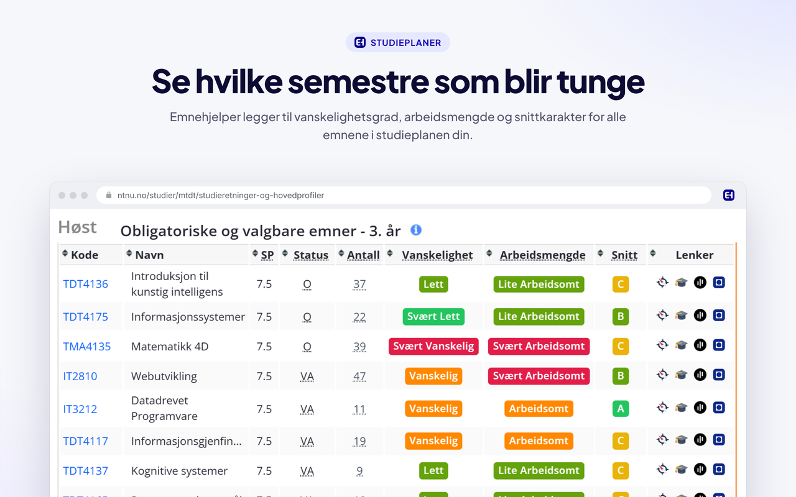
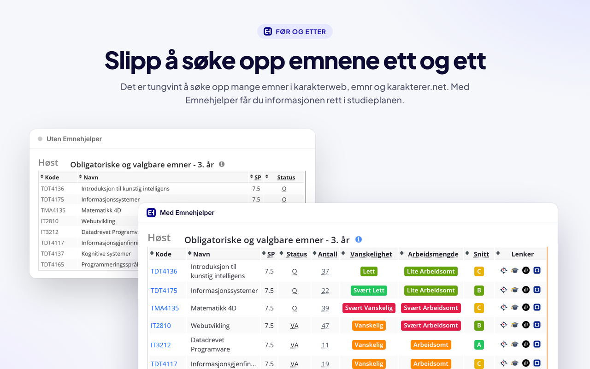
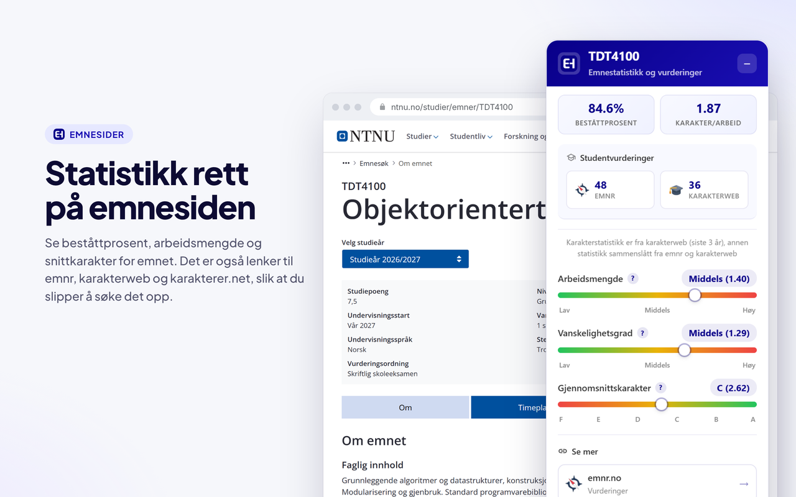
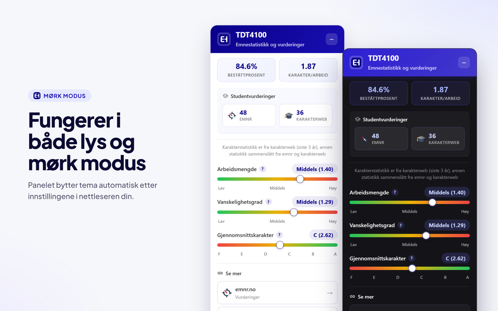
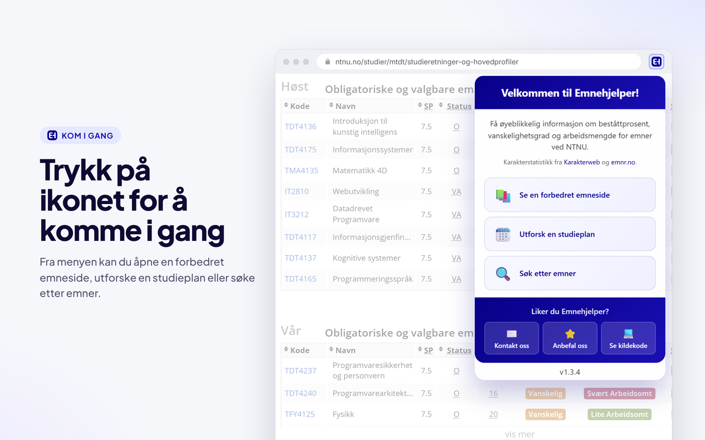
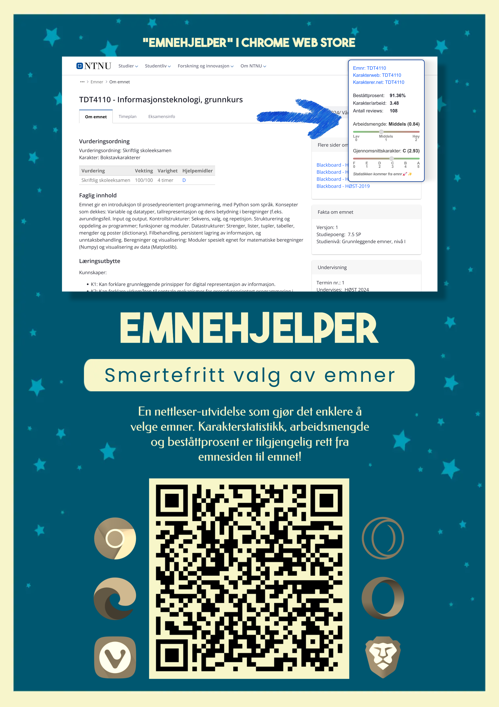

# Emnehjelper

Emnehjelper er en nettleser-utvidelse som har som formål å gjøre det enklere å velge hvilke NTNU-emner man skal ta. Når man skal velge emner er det nyttig å se statistikk om karakterer og arbeidsmengde, men det er tungvint å manuelt søke opp mange fag i tjenester som karakterweb, emnr og karakterer.net. 

Denne utvidelsen forbedrer studieplanene på sidene til NTNU ved å inkludere informasjon om vanskelighetsgrad, arbeidsmengde og karakterer i tabellene med alle emnene. På denne måten får du veldig enkelt oversikt over hvilke semestre som blir tunge og hvilke valgbare emner som gir de beste karakterene og minst arbeid. 

I tillegg til studieplaner, forbedrer denne utvidelsen emnesidene til alle NTNU-emner ved å inkludere statistikk om karakterer, beståttprosent og arbeidsmengde. Det er også lenker til emnet i tjenester som _emnr_, _karakterweb_ og _karakterer.net_ slik at du slipper å søke det opp. 

Statistikken som blir brukt er et vektet gjennomsnitt fra emnr og karakterweb. Dette gjør statistikken mer representativ enn om du manuelt hadde brukt bare én av disse tjenestene.

Karakterweb-data hentes via en cachet backend (Cloudflare Worker) slik at utvidelsen ikke treffer Karakterwebs API direkte fra hver bruker.

🎓 Din akademiske reise har nettopp blitt litt enklere ✨

## Hvordan installere?

Du kan installere Emnehjelper på alle [Chromium-baserte](https://alternativeto.net/category/browsers/chromium-based/) nettlesere (Google Chrome, Microsoft Edge, Opera, Brave, Vivaldi osv.) fra Chrome Web Store [her](https://chromewebstore.google.com/detail/emnehjelper/ocfgbjjagbojipkdhbloaegpigmkgiaf).

## Bildekatalog

|       |
| ------------------------------------------------------------------------------------------------------ |
| Dette bildet viser en studieplan med vanskelighetsgrad, arbeidsmengde og snittkarakter for hvert emne. |

|  |
| ----------------------------------------------------------------------------------- |
| Dette bildet viser en studieplan med og uten Emnehjelper.                           |

|  |
| ------------------------------------------------------------------------ |
| Dette bildet viser panelet med statistikk på emnesiden til TDT4100.      |

|  |
| --------------------------------------------------------------------------------- |
| Dette bildet viser panelet i lys og mørk modus.                                   |

|   |
| ---------------------------------------------------------------------------- |
| Dette bildet viser menyen som åpnes når du trykker på ikonet til utvidelsen. |

|  |
| ----------------------------------------------------------------------------------------------- |
| Denne GIFen viser hvordan man kan dra rundt på popupen på emnesiden.                            |

|  |
| ------------------------------------------------------------- |
| Dette er en plakat for å spre det gode ord 😉                 |
